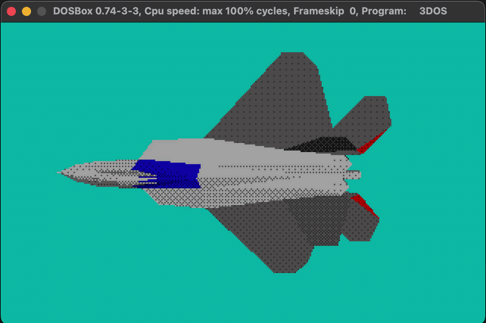

# 3DOS

3DOS is a low-poly old-school software renderer for MS-DOS written in C and x86 assembly. You can download the `EXE` file from [itch.io](https://xms0g.itch.io/3dos).

## Features
- **Software rasterization** — render 3D geometry using a CPU-based pipeline.
- **Low-poly meshes** — hand-crafted models defined by vertices and triangular faces.
- **Backface culling** — skip faces pointing away from the camera.
- **VGA Mode 13h** — target the classic 320 × 200, 256-color graphics mode.
- **Palette-based rendering** — work within a fixed color palette.
- **Ordered dithering** — experiment with Bayer matrices for lighting and color quantization.
- **Double buffering** - render frames to an off-screen buffer before displaying them to reduce flicker.

## Controls
| Key  | Description |
|------|-------------|
|`WASD`|Move         |
|`↑ ↓` |Fly up/down  |
|`ESC` |Exit         |
|`1/2/3/4`| Cube/Ico/Tree/F22|

## Screenshots

## License
This project is licensed under the BSD 3-Clause License. See the LICENSE file for details.
