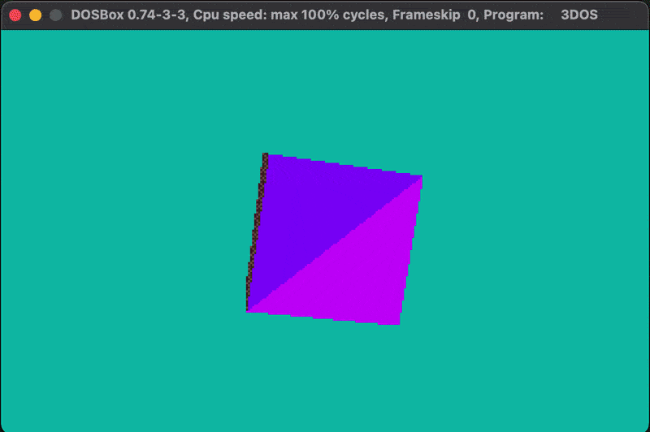
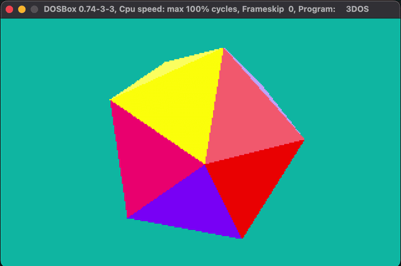
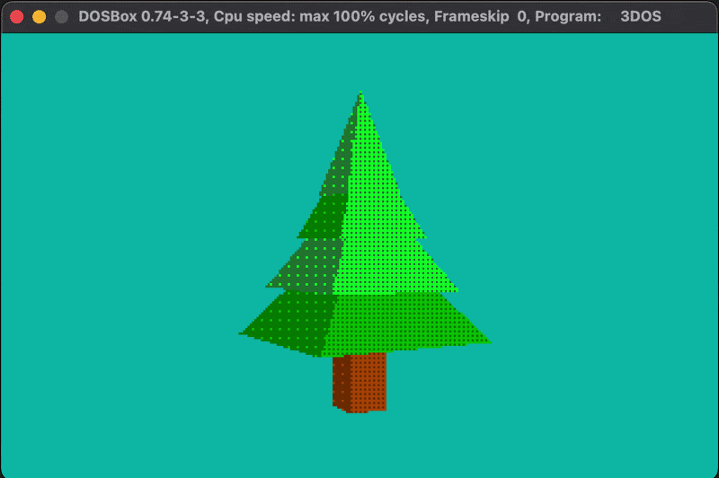
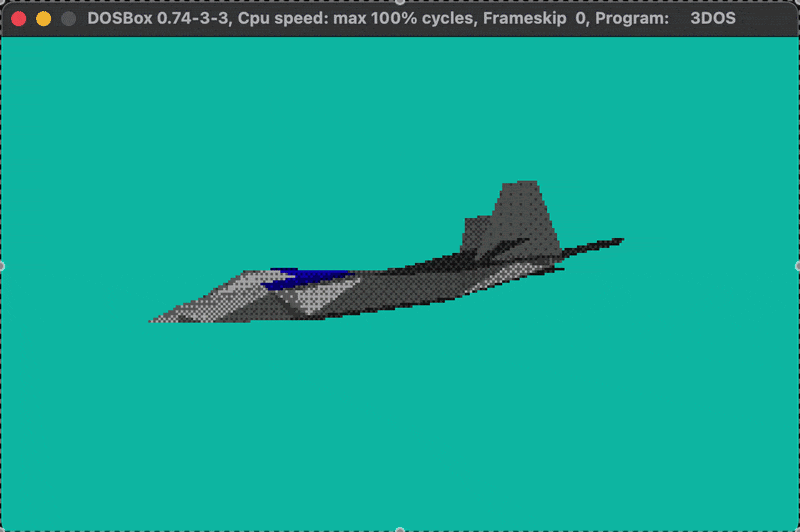

# 3DOS

3DOS is a low-poly old-school software renderer for MS-DOS written in C and x86 assembly, targeting VGA mode 13h at 320x200 resolution.  You can download the `EXE` file from [itch.io](https://xms0g.itch.io/3dos).

## Features
- Triangle rasterization
- 3D perspective projection
- Simple vector/matrix math with LUT-based sin/cos
- Backface culling
- Ordered dithering with 4x4 bayer matrix
- Double buffering
- Assembly-optimized framebuffer transfer - x86 REP MOVSW with far pointers for copying pixels to VGA memory.
- Low-level keyboard input — custom interrupt handler with key press and release detection.
## Controls
| Key  | Description |
|------|-------------|
|`WASD`|Move         |
|`↑ ↓` |Fly up/down  |
|`ESC` |Exit         |
|`1/2/3/4`| Cube/Ico/Tree/F22|

## Screenshots

## License
This project is licensed under the BSD 3-Clause License. See the LICENSE file for details.
